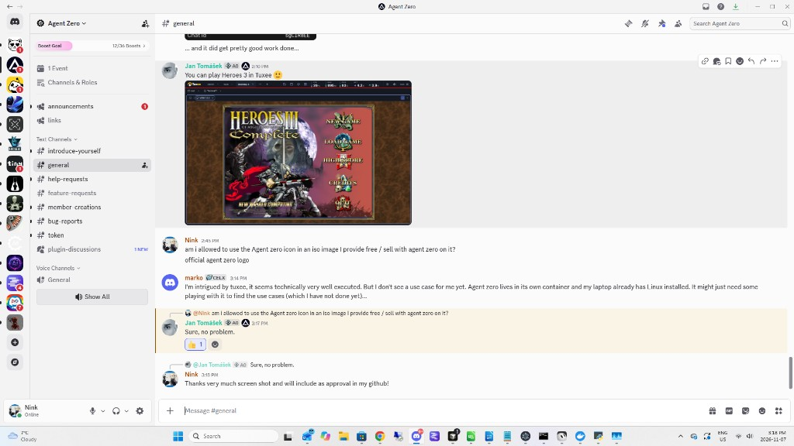

# Agent Zero logo — permission to use

StickLLM ships Agent Zero and displays the **official Agent Zero logo** (the
“A0” mark from [agent0ai/agent-zero](https://github.com/agent0ai/agent-zero))
on the desktop icon and related UI.

## Approval

On the Agent Zero Discord (`#general`), **Jan Tomášek** (Agent Zero admin /
official) granted permission when asked whether StickLLM may use the official
Agent Zero icon on an ISO that is provided free or sold with Agent Zero on it:

> **Nink:** am i allowed to use the Agent zero icon in an iso image I provide
> free / sell with agent zero on it? official agent zero logo
>
> **Jan Tomášek:** Sure, no problem.

Screenshot of that exchange (for the GitHub record):

## Asset source

- Official collapsed mark used in-product:
  [`webui/public/a0-collapsed.svg`](https://github.com/agent0ai/agent-zero/blob/main/webui/public/a0-collapsed.svg)
  in the Agent Zero repository.
- StickLLM copies: `ui/agent-zero.svg`, `ui/agent-zero.png` (raster for the
  desktop icon), and the older astronaut artwork is retired.

Agent Zero remains a separate project with its own license; this note only
covers **logo / trademark use** as approved above.
